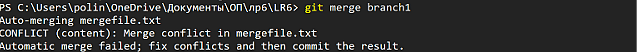
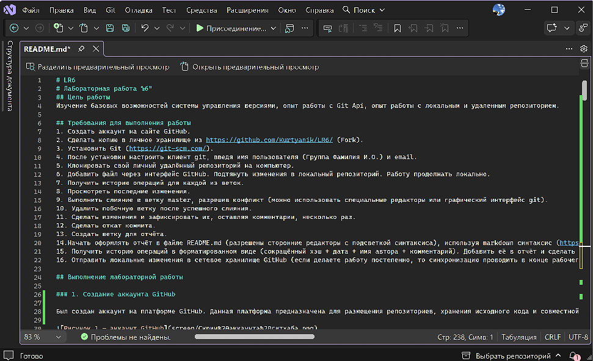
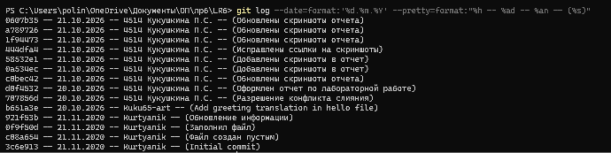

# LR6
# Лабораторная работа №6" 
## Цель работы
Изучение базовых возможностей системы управления версиями, опыт работы с Git Api, опыт работы с локальным и удаленным репозиторием.

## Требования для выполнения работы
1. Создать аккаунт на сайте GitHub.
2. Сделать копию в личное хранилище из https://github.com/Kurtyanik/LR6/ (Fork).
3. Установить Git (https://git-scm.com/).
4. После установки настроить клиент git, введя имя пользователя (Группа Фамилия И.О.) и email.
5. Клонировать свой личный удалённый репозиторий на компьютер.
6. Добавить файл через интерфейс GitHub. Подтянуть изменения в локальный репозиторий. Работу продолжать локально.
7. Получить историю операций для каждой из веток.
8. Просмотреть последние изменения.
9. Выполнить слияние в ветку master, разрешив конфликт (можно использовать специальные редакторы или графический интерфейс git).
10. Удалить побочную ветку после успешного слияния.
11. Сделать изменения и зафиксировать их, оставляя комментарии, несколько раз.
12. Сделать откат коммита.
13. Создать ветку для отчёта.
14.Начать оформлять отчёт в файле README.md (разрешены сторонние редакторы с подсветкой синтаксиса), используя markdown синтаксис (https://guides.github.com/features/mastering-markdown/)
15. Получить историю операций в форматированном виде (сокращённый хэш + дата + имя автора + комментарий). Добавить её в отчёт и сделать финальную фиксацию изменений.
16. Отправить локальные изменения в сетевое хранилище GitHub (если делаете работу постепенно, то синхронизацию проводить в конце рабочего сеанса)

## Выполнение лабораторной работы

### 1. Создание аккаунта GitHub

Был создан аккаунт на платформе GitHub. Данная платформа предназначена для размещения репозиториев, хранения исходного кода и совместной работы над программными проектами (рис.1).

<p align="center">
  
  <br>
  <em>Рисунок 1 — созданный аккаунт GitHub.</em>
</p>


### 2. Создание копии репозитория

Далее была создана копия репозитория https://github.com/Kurtyanik/LR6/ в личное хранилище (рис.2).

<p align="center">
  
  <br>
  <em>Рисунок 2 — создание копии репозитория.</em>
</p>


### 3. Установка Git

Для установки Git необходимо перейти на страницу https://git-scm.com и скачать нужную версию на компьютер.


### 4. Настройка клиента Git

Далее была выполнена настройка Git. Необходимо было указать номер группы, ФИО и адрес электронной почты автора.
Это было сделано с помощью команд `git config --global user.name "(username)"` и `git config --global user.email "(email)"` (рис.3).

<p align="center">
  
  <br>
  <em>Рисунок 3 — добавление данных пользователя.</em>
</p>


### 5. Клонирование удалённого репозитория на компьютер

Для начала была выбрана папка на локальном компьютере, в которую будет скопирован удалённый репозиторий.

<p align="center">
  
  <br>
  <em>Рисунок 4 — выбор папки для работы с репозиторием.</em>
</p>

С помощью команды `git clone` удалённый репозиторий был скопирован на локальный компьютер (рис.5).

<p align="center">
  
  <br>
  <em>Рисунок 5 — клонирование удалённого репозитория.</em>
</p>

После клонирования была открыта папка проекта `LR6`, в которой размещаются файлы (рис.6).

<p align="center">
  
  <br>
  <em>Рисунок 6 — проверка содержимого рабочей папки.</em>
</p>


### 6. Добавление файла через интерфейс GitHub и подтягивание изменений в локальный репозиторий

Далее был создан файл hello через интерфейс GitHub. В файл было добавлено приветствие с переводом (рис.7).

<p align="center">
  
  <br>
  <em>Рисунок 7 — создание файла hello.</em>
</p>

После сохранения файла изменение появилось в удалённом репозитории (рис.8).

<p align="center">
  
  <br>
  <em>Рисунок 8 — файлы в удалённом репозитории.</em>
</p>

Чтобы получить локальную копию файла, была выполнена команда `git pull` (рис.9).

<p align="center">
  
  <br>
  <em>Рисунок 9 — добавление файла в локальный репозиторий.</em>
</p>

С помощью `git ls-files` был выведен список файлов, которые находятся в репозитории (рис.10).

<p align="center">
  
  <br>
  <em>Рисунок 10 — проверка содержимого проекта.</em>
</p>


### 7. Получение истории операций для каждой из веток

Для просмотра истории изменений в репозитории использовалась команда `git log` (рис.11).

<p align="center">
  
  <br>
  <em>Рисунок 11 — просмотр истории операций для одной из веток.</em>
</p>

Для просмотра истории с информацией о всех ветках применялась команда `git log --oneline --graph --all` (рис.12).

<p align="center">
  
  <br>
  <em>Рисунок 12 — просмотр истории операций для всех веток.</em>
</p>


### 8. Просмотр последних изменений

Для просмотра информации о последних изменениях использовалась команда `git show` (рис.13).

<p align="center">
  
  <br>
  <em>Рисунок 13 — просмотр информации о последних изменениях.</em>
</p>


### 9. Выполнение слияния в ветку master, разрешив конфликт

Для выполнения слияния была создана ветка branch1, в которой тоже находился файл mergefile.txt (рис.14).

<p align="center">
  
  <br>
  <em>Рисунок 14 — просмотр веток репозитория.</em>
</p>

Из-за различий в содержимом файла mergefile.txt при слиянии возник конфликт.
Для объединения изменений использовалась команда `git merge branch1` (рис.15).

<p align="center">
  
  <br>
  <em>Рисунок 15 — возникновение конфликта при слиянии.</em>
</p>

Для просмотра различий между версиями файла можно воспользоваться командой `git diff` (рис.16).

<p align="center">
  
  <br>
  <em>Рисунок 16 — просмотр различий между версиями файла.</em>
</p>


Для разрешения конфликта файл mergefile.txt был открыт (рис.17) и отредактирован в VS (рис.18).

<p align="center">
  
  <br>
  <em>Рисунок 17 — открытие файла `mergefile.txt`.</em>
</p>


<p align="center">
  
  <br>
  <em>Рисунок 18 — изменение содержимого файла для разрешения конфликта.</em>
</p>


Далее с помoщью команды `git add` были добавлены изменения в индекс Git и проверен статус с `git status` (рис.19).

<p align="center">
  
  <br>
  <em>Рисунок 19 — добавление изменений и проверка статуса.</em>
</p>

Для завершения слияния был добавлен коммит с помощью команды `git commit -m "(Комментарий)"` (рис.20).

<p align="center">
  
  <br>
  <em>Рисунок 20 — создание коммита.</em>
</p>


### 10. Удаление побочной ветки

После слияния ветки branch1 с веткой master была удалена дополнительная ветка (рис.21).
Для удаления локальной ветки использовалась команда `git branch -d branch1`
Удаление ветки на удалённом репозитории выполнялось командой `git push origin --delete branch1`

<p align="center">
  
  <br>
  <em>Рисунок 21 — удаление ветки `branch1` из удалённого репозитория.</em>
</p>


### 11. Создание изменений и их фиксация

Для отслеживания изменений  несколько раз выполнялись редактирование файлов и создание коммитов.
Для создания изменений в файле README.md был добавлен коммит (рис.22).

<p align="center">
  
  <br>
  <em>Рисунок 22 — создание коммита с файлом `README.md`.</em>
</p>

Перед фиксацией изменений проверялось состояние рабочего каталога с помощью команды `git status`.


### 12. Откат коммита

Для выполнения отката коммита использовалась команда `git reset --soft HEAD~1`. Она перемещает указатель текущей ветки на предыдущий коммит.

После выполнения команды была проверена история коммитов с помощью `git log` (рис.24).

<p align="center">
  
  <br>
  <em>Рисунок 23 — просмотр истории коммитов перед отменой последнего коммита.</em>
</p>


<p align="center">
  
  <br>
  <em>Рисунок 24 — проверка истории после отмены последнего коммита.</em>
</p>


### 13. Создание ветки для отчёта

Для выполнения отчёта была создана отдельная ветка report.
Для создания и переключения на новую ветку использовалась команда `git switch -c report` (рис.25).

<p align="center">
  
  <br>
  <em>Рисунок 25 — переключение на ветку для отчёта.</em>
</p>


### 14. Оформление отчёта в файле README.md

Для написания отчёта использовался редактор кода VS. В файле были описаны этапы выполнения лабораторной работы, использованные команды Git и добавлены скриншоты, подтверждающие выполнение заданий (рис. 27).

<p align="center">
  
  <br>
  <em>Рисунок 26 — оформление отчёта в файле README.md.</em>
</p>


### 15. Получение истории операций в форматированном виде

Для получения истории операций в форматированном виде, включающей сокращённый хэш коммита, дату, имя автора и комментарий, использовалась команда `git log --date=format:'%d.%m.%Y' --pretty=format:"%h -- %ad -- %an -- (%s)"` (рис. 28).

<p align="center">
  
  <br>
  <em>Рисунок 27 — история операций в форматированном виде.</em>
</p>


### 16. Отправка локальных изменений в сетевое хранилище GitHub

В созданную ветку report был добавлен файл README.md с описанием выполнения лабораторной работы и скриншотами основных этапов.
После оформления отчёта изменения были зафиксированы коммитом и отправлены в удалённый репозиторий (рис.28).

<p align="center">
  
  <br>
  <em>Рисунок 28 — отправка изменений в GitHub.</em>
</p>


## История операций Git

 `707856d`  Разрешение конфликта слияния 

`0607b35` -- 21.10.2026 -- 4514 Кукушкина П.С. -- (Обновлены скриншоты отчета)

`a789726` -- 21.10.2026 -- 4514 Кукушкина П.С. -- (Обновлены скриншоты отчета)

`1f94473` -- 21.10.2026 -- 4514 Кукушкина П.С. -- (Обновлены скриншоты отчета)

`444dfa4` -- 21.10.2026 -- 4514 Кукушкина П.С. -- (Исправлены ссылки на скриншоты)

`58532e1` -- 21.10.2026 -- 4514 Кукушкина П.С. -- (Добавлены скриншоты в отчет)

`0a534ec` -- 21.10.2026 -- 4514 Кукушкина П.С. -- (Добавлены скриншоты в отчет)

`c0bec42` -- 21.10.2026 -- 4514 Кукушкина П.С. -- (Обновлены скриншоты отчета)

`d0f4532` -- 20.10.2026 -- 4514 Кукушкина П.С. -- (Оформлен отчет по лабораторной работе)

`707856d` -- 20.10.2026 -- 4514 Кукушкина П.С. -- (Разрешение конфликта слияния)

`b651a3e` -- 20.10.2026 -- Kuku65-art -- (Add greeting translation in hello file)

`921f53b` -- 21.11.2020 -- Kurtyanik -- (Обновление информации)

`0f9f50d` -- 21.11.2020 -- Kurtyanik -- (Заполнил файл)

`c08a654` -- 21.11.2020 -- Kurtyanik -- (Файл создан пустым)

`3c6e913` -- 21.11.2020 -- Kurtyanik -- (Initial commit)

## Основные использованные команды

```bash
git config --global user.name
git config --global user.email
git clone
git status
git ls-files
git pull
git show
git branch -a
git log --oneline --all --graph
git add
git commit -m
git merge
git push
git push origin --delete branch1
git branch -d branch1
git reset --soft HEAD~1
git switch -c report
```

## Результат работы

В ходе выполнения лабораторной работы были изучены базовые операции Git, такие как: клонирование репозитория, просмотр истории, создание коммитов, работа с ветками, слияние изменений, разрешение конфликта, отмена коммита и отправка изменений на GitHub.


